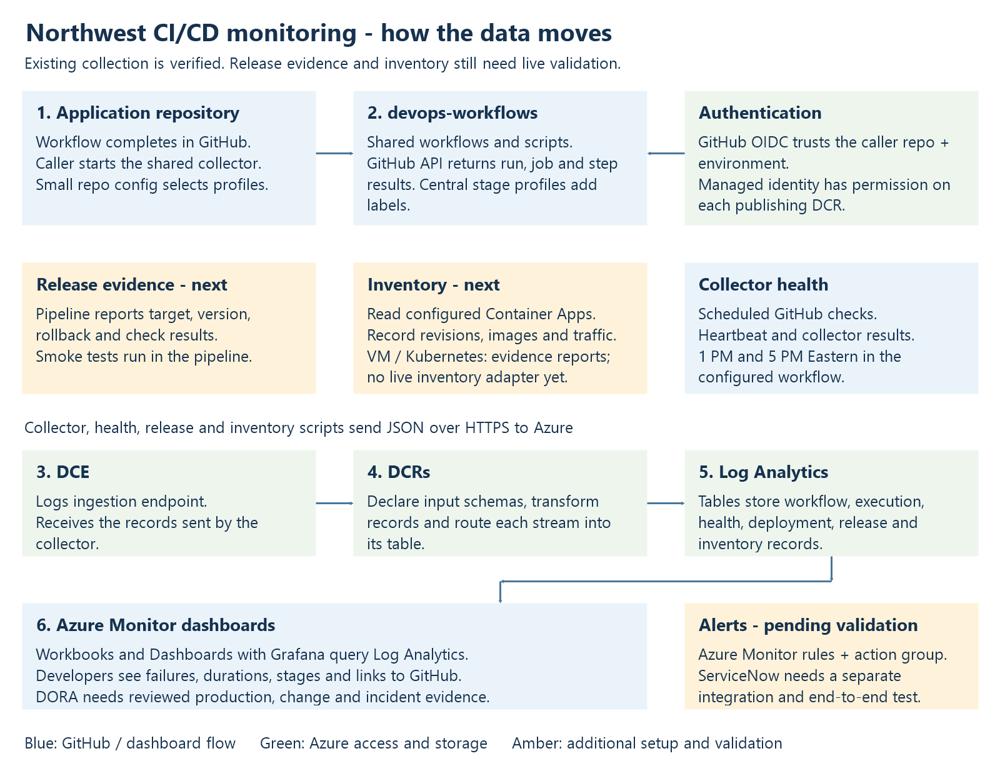

# Northwest CI/CD monitoring - setup and how to use it

Prepared on 10 November 2026. This guide follows the local monitoring package and the runs we have checked together. The latest devops-workflows merge is reported as completed. New release tracking features still need the Azure setup and live checks below.

## 1. What we are doing

We are collecting CI/CD results from GitHub and showing them in Azure Monitor. The team can see which workflow passed or failed, where it failed, how long each job took, and open the original run to investigate.

We keep the common scripts in devops-workflows. Application repositories use those shared workflows. This means we fix the collection logic once and other onboarded repositories can use the same change.

For example, the bank releases a change to document extraction. The build passes, but the smoke test cannot process a test document after deployment. We want the dashboard to show the successful deployment and the failed smoke check separately. A green build alone does not confirm that the release is working.

Application Insights was created for frontend and backend application telemetry. Our current delivery is CI/CD monitoring. Application performance monitoring is a separate activity.

## 2. Where we are now

| Area | What we have done | What is still needed |
| --- | --- | --- |
| Azure foundation | Workspace, endpoint, managed identity and the original collection rules were created. | Verify new release resources after deployment. |
| Authentication | GitHub OIDC login and publishing worked on the Windows runner. | Add federation for each new caller repository/environment. |
| Workflow collection | Workflow, job and step records reached Log Analytics. Automatic collection worked after application runs. | Validate coverage against recent GitHub runs, including failures and retries. |
| Shared stages | The shared delivery profile produced mapped stages in the dashboard. | Add reviewed mappings for the remaining jobs and actual post-deployment checks. |
| Collector health | Heartbeat and collector-run observations reached Azure. | Confirm the new twice-daily schedule in live runs and align alerts. |
| Dashboards | CI/CD Workbook and Azure Monitor Dashboards with Grafana were used with real data. | Import the latest DORA/release dashboard and validate each section. |
| Release and version tracking | Code and configuration examples are in the package. | Create the new tables/DCR, publish real release evidence and test inventory. |
| DORA | Dashboard queries and presentation are prepared. | Confirm production classification, change links, incidents and rework evidence. |
| Alerts and ServiceNow | Disabled Azure alert templates are available. | Agree thresholds, test notifications and implement/validate ServiceNow integration. |

## 3. Architecture and where collection happens



Main flow: application workflow finishes -> caller collector workflow -> shared reusable workflow -> shared PowerShell action -> GitHub API -> Azure Logs Ingestion API -> DCR transformation and routing -> Log Analytics tables -> dashboards.

1. GitHub sends a workflow_run completion event in the application repository.
2. The small caller workflow checks whether collection is enabled and excludes monitoring workflows themselves.
3. The shared workflow checks out the caller's monitoring configuration and signs in to Azure when publishing is enabled.
4. Invoke-SharedAction.ps1 starts Invoke-CicdCollection.ps1. That script coordinates workflow results, job/step results and confirmed deployment collection.
5. The scripts read GitHub APIs using the caller's GITHUB_TOKEN. They build structured records. They do not need to scrape the screen or read every log line.
6. NwbTransport.ps1 sends those records to the Logs Ingestion API using the endpoint, DCR immutable ID and stream name.
7. Azure stores the records. Workbook and Grafana queries read them. An API acceptance message is followed by a query check to confirm the records arrived.

There are two additional flows. The health workflow checks recent collector results and publishes a heartbeat. The release action accepts evidence from the delivery pipeline; the inventory workflow separately reads configured Container App versions from Azure.

## 4. Why we created each Azure service

| Service | Why it is needed | Banking example |
| --- | --- | --- |
| Log Analytics workspace | Stores and queries our monitoring records in one place. | Compare document-extraction pipeline results over the last week. |
| Custom tables | Give each record type a clear schema, so queries can join and compare records reliably. | Keep a deployment record separate from 40 individual build steps. |
| Data Collection Endpoint (DCE) | Provides the ingestion address used by our implementation. It does not collect GitHub data itself. | The collector needs an address where it can submit the release records. |
| Data Collection Rule (DCR) | Defines incoming columns, any transformations and the destination table/workspace. | Route a failed smoke-check report to the release evidence table rather than the workflow summary table. |
| Managed identity | Gives the publishing job an Azure identity without a stored client secret. | Only the approved collector can send records to its assigned DCRs. |
| Federated credential | Establishes trust between the caller's GitHub OIDC identity and the managed identity. | A new bank repository must be onboarded before it can use the collector identity. |
| Application Insights | Supports application requests, dependencies and failures when the application sends telemetry. | Investigate slow document processing inside the application; this is separate from our CI/CD result collection. |
| Workbook / Dashboards with Grafana | Presents the Log Analytics records as charts, tiles and investigation views. | A developer sees the failed stage and follows its GitHub run link. |

A DCE is used by this setup. Some Azure ingestion designs support a DCR ingestion endpoint instead; do not change our endpoint approach as part of routine onboarding.

## 5. Azure resources and tables

Subscription: NWPROD-SUB. Resource group: prd-cicdobservability-rg-eus2. Region: East US 2. Workspace: prd-cicdobservability-law-eus2. Identity: prd-cicdobservability-collector-mi-eus2.

| Table | What it stores | DCR name suffix |
| --- | --- | --- |
| NWBWorkflowRuns_CL | One observation of a workflow attempt: outcome, timing, repository, run link and attribution. | workflows-dcr-eus2 |
| NWBPipelineExecution_CL | Individual jobs and steps, timings and stage labels. | execution-health-dcr-eus2 |
| NWBCollectorHealth_CL | Collection results, observed collector runs and heartbeats. | execution-health-dcr-eus2 |
| NWBDeploymentFacts_CL | Confirmed deployment facts, with service/environment and deployment identity. | deployments-dcr-eus2 |
| NWBChangeFacts_CL | Changes linked to deployments, including lead-time evidence. | changes-dcr-eus2 |
| NWBIncidentFacts_CL | Deployment-related failure and restoration evidence. | incidents-dcr-eus2 |
| NWBReleaseEvidence_CL | Release, rollback, version and required-check evidence from pipelines. | release-evidence-dcr-eus2 |
| NWBVersionInventory_CL | Observed versions and revisions from supported inventory reads. | release-evidence-dcr-eus2 |

Each DCR name starts with prd-cicdobservability-. The release-evidence DCR and its two tables are new setup items; their live deployment is not confirmed here. A table existing does not mean its data source is already connected.

## 6. How to set up the infrastructure

These are repeatable setup instructions, not a claim that every historical portal click was recorded. For the existing bank resources, inspect and update them instead of creating duplicates.

### Step 1 - Workspace and endpoint

1. Open Azure Portal > Log Analytics workspaces. Open prd-cicdobservability-law-eus2. For a new installation, use Create, select the approved subscription/resource group and East US 2, then review and create.
2. Open Monitor > Data Collection Endpoints. Open prd-cicdobservability-dce-eus2. For a new installation, create the endpoint in the approved region and configure the network access required by the runner.
3. On the endpoint Overview, copy Logs ingestion. This is AZURE_DCE_LOGS_ENDPOINT.
4. Open its JSON view or Properties and copy the full resource ID. This is the DCE ID used in ARM template parameters. It is different from the ingestion URL.

### Step 2 - Tables and rules

1. Open the workspace > Tables and inspect the existing schemas. Keep the exact column names and types used by the collector.
2. For execution and health, open Deploy a custom template > Build your own template in the editor. Load monitoring/infra/execution-health.json.
3. Supply the existing workspace, region, DCE resource ID and prd-cicdobservability-execution-health-dcr-eus2. Review the resources, then deploy.
4. For release evidence and inventory, repeat with monitoring/infra/release-evidence.json and prd-cicdobservability-release-evidence-dcr-eus2. This adds its two tables and rule.
5. The original workflow/deployment/change/incident rules already exist. Preserve their endpoint, destinations, schemas and transformations when updating them. The execution-health template does not create those four original tables.
6. In each DCR JSON view, check streamDeclarations, dataFlows, destination workspace and outputStream. Copy the immutableId, which starts with dcr-, for the GitHub variable. Do not put the ARM resource ID into an immutable-ID variable.

### Step 3 - New workflow attribution columns

1. Open workspace > Tables > NWBWorkflowRuns_CL > Edit schema.
2. Add Actor, TriggeringActor and RunNumber as String, if missing. Preserve SourceUpdatedAt and the other existing columns.
3. Add the same columns as string in the workflow DCR input stream declaration through the existing DCR deployment process. A source transformation passes them through; a project transformation must explicitly include them.
4. monitoring/infra/workflow-attribution-columns.json is only the list of additions. Do not deploy it as a complete ARM template.
5. Publish a recent run and verify the fields. Old rows are not automatically rewritten.

### Step 4 - Managed identity and permissions

1. Open Managed Identities > prd-cicdobservability-collector-mi-eus2. For a new installation, create a user-assigned identity and record its client ID and tenant ID.
2. Open each publishing DCR > Access control (IAM) > Add role assignment.
3. Select Monitoring Metrics Publisher > Managed identity > User-assigned managed identity > the collector identity > Review + assign.
4. Include the new release-evidence DCR when enabling that feature. Use DCR scope for publishing.
5. Inventory additionally needs read permission on each configured Container App resource. Publishing permissions alone do not grant Azure resource read access.

### Step 5 - GitHub federation

1. Open the managed identity > Settings > Federated credentials > Add Credential.
2. Use the external OpenID Connect provider option and the exact claims from the Azure login log.
3. For doc_extraction, issuer is https://token.actions.northwest.ghe.com, subject is repo:northwest/doc_extraction:environment:cicd-observability and audience is api://AzureADTokenExchange.
4. Save with a descriptive unique name. The caller repository belongs in the subject even though the code runs from devops-workflows.
5. Add a matching credential when onboarding another caller repository/environment. Do not substitute an organization wildcard into an exact subject field.

## 7. GitHub setup

1. In devops-workflows, open Settings > Actions > General > Access. Allow the intended repositories in the northwest organization to use its shared workflows/actions, subject to the organization's policy.
2. In the application repository, create environment cicd-observability under Settings > Environments. Apply the intended branch and approval controls. An approval requirement will also affect unattended collection.
3. Under Settings > Secrets and variables > Actions > Variables, add the repository control variables below. They must be available when the caller evaluates its job conditions.
4. Put the collector's Azure configuration in the cicd-observability environment variables. This keeps the collector identity separate from the application's deployment identity.
5. Confirm the approved runner is available to the caller repository. Our working runner is Windows x64 with PowerShell 7 and Azure CLI installed and accessible to the runner service account.

| Variable | Value or where to obtain it |
| --- | --- |
| CICD_MONITOR_RUNNER_LABELS | ["self-hosted","Windows","X64"] for the currently approved runner. |
| CICD_MONITOR_AUTOMATION_ENABLED | true to enable automatic application-run collection. |
| CICD_MONITOR_AUTO_PUBLISH | true to publish automatic collection to Azure. |
| CICD_MONITOR_HEALTH_ENABLED | true to enable scheduled collector health. |
| CICD_MONITOR_HEALTH_PUBLISH | true to publish scheduled health records. |
| AZURE_CLIENT_ID | Collector managed identity Overview > Client ID. |
| AZURE_TENANT_ID | Tenant/directory ID containing that identity. |
| AZURE_SUBSCRIPTION_ID | 18af3db6-624c-4522-9319-35501eb3fac0 for this setup. |
| AZURE_DCE_LOGS_ENDPOINT | DCE Overview > Logs ingestion URL. |
| AZURE_WORKFLOW_DCR_IMMUTABLE_ID | Workflow DCR immutableId. |
| AZURE_DEPLOYMENT_DCR_IMMUTABLE_ID | Deployment DCR immutableId. |
| AZURE_EXECUTION_DCR_IMMUTABLE_ID | Execution-health DCR immutableId. |
| AZURE_HEALTH_DCR_IMMUTABLE_ID | Same execution-health DCR immutableId. |
| AZURE_RELEASE_DCR_IMMUTABLE_ID | New release-evidence DCR immutableId, for release/inventory publishing. |

GITHUB_TOKEN is supplied by GitHub. id-token: write allows the job to request an OIDC token; it does not give repository write access. The shared workflows use @main as agreed, so reviewed changes to central main are used by subsequent runs. Protect that branch and test changes before merging.

## 8. What goes in each repository

| Location | What belongs there and why |
| --- | --- |
| devops-workflows/.github/workflows | Shared reusable workflow definitions. Other repositories call these. |
| devops-workflows/actions | Composite actions and PowerShell implementation. Keep common collection logic here. |
| devops-workflows/monitoring/config | Examples and onboarding guidance. These examples are not automatically the caller's runtime configuration. |
| devops-workflows/monitoring/infra | Azure templates, schema additions and template generators. |
| devops-workflows/monitoring/queries | Queries for verification, investigation and alert evaluation. |
| devops-workflows/monitoring/grafana | Grafana dashboard JSON, builders, tests and instructions. |
| devops-workflows/monitoring/workbooks | Azure Workbook JSON, builder, tests and instructions. |
| devops-workflows/monitoring/tests | Offline regression checks for collection and record handling. |
| devops-workflows/monitoring/docs and monitoring.md | Setup, operations, migration and feature explanations. |
| doc_extraction/.github/workflows | Small caller collector/health workflows, plus the application's own delivery workflows. |
| doc_extraction/config/nwb-observability/collector.json | Caller-specific service, profile and optional mapping configuration. |

In our local packaging repository, these are under repository-split/devops-workflows and repository-split/doc_extraction. Copy the contents into the corresponding bank repositories without those packaging prefixes. Root scripts, templates, infra and tests in monitoring-scripts-azure are standalone/package copies; they are not an extra copy to put into devops-workflows.

## 9. What each workflow and script does

Paths in this section are relative to devops-workflows unless stated otherwise.

| Workflow or action | What it does and why |
| --- | --- |
| Caller .github/workflows/nwb-cicd-collector.yml | Reacts to completed application workflows or a manual replay. Passes the run and publishing settings to the shared collector. |
| Caller .github/workflows/nwb-collector-health.yml | Runs health checks at 1 PM and 5 PM Eastern, or manually. It checks the monitoring process rather than deploying the application. |
| .github/workflows/nwb-cicd-collector-reusable.yml | Selects the runner, reads caller configuration, signs in when publishing and calls the collector action. |
| .github/workflows/nwb-collector-health-reusable.yml | Provides the common health job and Azure publishing setup. |
| .github/workflows/nwb-version-inventory-reusable.yml | Reads configured Container App inventory and optionally publishes it. Preview still needs Azure read access. |
| actions/nwb-cicd-monitoring/action.yml | Makes the bundled collector scripts callable as one shared action. |
| actions/nwb-release-evidence/action.yml | Runs release evidence publishing or inventory. Checks installed PowerShell on Windows before running the scripts. |

The following files are under actions/nwb-cicd-monitoring/scripts.

| Script | What it does and why |
| --- | --- |
| Initialize-PowerShell.ps1 | Finds the installed PowerShell 7 runtime and makes it available to later steps. Current setup checks the installation; the administrator installs the runtime. |
| Invoke-SharedAction.ps1 | Reads action inputs and starts the requested collect or health operation. |
| Invoke-CicdCollection.ps1 | Coordinates workflow, execution and deployment collection and reports component failures. |
| Send-WorkflowRun.ps1 | Retrieves a workflow attempt and previews or publishes the workflow record. |
| WorkflowRecord.psm1 | Converts GitHub run metadata into the workflow schema, including timing and actor/run attribution. |
| Send-PipelineExecution.ps1 | Retrieves jobs and steps for the selected attempt and previews or publishes them. |
| PipelineRecord.psm1 | Builds job/step records and applies stage mappings while preserving unknown timings. |
| NwbStageProfiles.ps1 | Loads and resolves shared stage profiles, so repositories can reuse common mappings. |
| Send-RunDeployments.ps1 | Looks for confirmed deployments linked to the selected run. It does not invent a deployment from workflow success. |
| DeploymentRecord.psm1 | Validates deployment evidence and converts it into deployment facts. |
| Invoke-CollectorHealth.ps1 | Reads collector history, evaluates recent completed collector runs and produces a heartbeat. Stops instead of claiming health if history cannot be read completely. |
| CollectorHealth.ps1 | Builds consistent health observations for collection results and heartbeat reporting. |
| NwbRepository.ps1 | Resolves and validates the caller repository so collection stays in the intended repository context. |
| NwbTransport.ps1 | Shared HTTP, GitHub pagination and Azure ingestion helpers. Keeps transport behavior consistent across scripts. |
| Show-OidcClaims.ps1 | Displays selected issuer/subject/audience claims for federation troubleshooting. Do not print or share the full token. |
| Invoke-WorkflowEvent.ps1 | Supports the older event-based collection entry point. The current split setup enters through Invoke-SharedAction.ps1. |
| Send-ReleaseEvidence.ps1 | Reads a release report or performs inventory and previews/publishes the resulting records. |
| ReleaseEvidence.psm1 | Validates targets, environments, versions and required checks; builds release and inventory records. |

actions/nwb-cicd-monitoring/profiles/stages.json is the central stage dictionary. collector.json selects a profile such as nwb-delivery for delivery.yml. The collector discovers workflow/job/step metadata automatically; business environment and verification meanings still need trustworthy evidence or reviewed mapping.

## 10. What the supporting files do

| Folder and files | Purpose |
| --- | --- |
| monitoring/config/nwb-observability/collector.json | Starter configuration example. The active application copy is in the caller repository. |
| monitoring/config/stage-mapping-example.json | Shows how to map exact job and step names to stages. |
| monitoring/config/doc-extraction-stage-mapping-draft.json and .md | Draft mappings and explanation based on observed delivery names. Review before using. |
| monitoring/config/release-targets.example.json | Explicit service/environment/resource targets and required checks. |
| monitoring/config/release-discovery.example.json | Example allowing supported resource identities from release evidence, with required checks. |
| monitoring/config/release-report.example.json | Example report structure for deploy/rollback outcomes and verification checks. Replace examples with real pipeline evidence. |
| monitoring/config/nwb-version-inventory.example.yml | Optional caller workflow template for inventory; copy and configure only when enabling inventory. |
| monitoring/infra/execution-health.json | Creates the execution and health tables and their DCR. |
| monitoring/infra/record-schemas.json | Defines execution/health record schemas used by the package. |
| monitoring/infra/workflow-attribution-columns.json | Lists Actor, TriggeringActor and RunNumber additions; not a complete template. |
| monitoring/infra/Build-ReleaseEvidenceTemplate.ps1 and release-evidence.json | Generator and deployable template for release evidence/inventory tables and DCR. |
| monitoring/infra/Build-AlertTemplate.ps1 and alerts-disabled.json | Generator and disabled alert definitions. Importing dashboards does not deploy these alerts. |
| monitoring/grafana/Build-CicdGrafana.ps1 and nwb-cicd-monitoring.grafana.json | Builder and importable CI/CD Grafana dashboard. |
| monitoring/grafana/Build-DoraGrafana.ps1 and nwb-dora-monitoring.grafana.json | Builder and importable DORA/release/investigation dashboard. |
| monitoring/grafana/post-deployment-mapping-example.json | Example verification-stage mappings. Match actual post-deployment job/step names. |
| monitoring/grafana/README.md and DORA-README.md | Import instructions, metrics and validation details. |
| monitoring/workbooks/Build-CicdWorkbook.ps1 and nwb-cicd-monitoring.workbook.json | Builder and importable Azure Workbook. This is a separate artifact from Grafana JSON. |
| monitoring/workbooks/README.md | Workbook setup and use. |
| monitoring/docs/README.txt, MOVE-KEEP-CHANGE.txt and monitoring.md | Operating guide and repository migration instructions. |
| monitoring/docs/RELEASE-MONITORING.md | Detailed release publisher and inventory setup. |
| monitoring/docs/SHARED-PROFILES-AND-DASHBOARDS.md | Shared mapping and dashboard guidance. |
| monitoring/docs/PR-7-REVIEW-NOTES.md | Historical review notes; use the current code and operating guide for setup. |

| Query under monitoring/queries | What to use it for |
| --- | --- |
| verify-workflow.kql | Confirm workflow attempts reached Azure. |
| verify-deployments.kql | Inspect deduplicated deployment facts. |
| pipeline-jobs.kql / pipeline-steps.kql | Inspect job and step results separately. |
| stage-coverage.kql | Find mapped/unmapped execution records. |
| collector-health.kql | Review collection and heartbeat observations. |
| alert-selected-workflows.kql | Evaluate failures for the agreed application workflow selection. |
| alert-heartbeat-missing.kql | Detect missing expected health observations using the configured cadence. |
| alert-collector-failed.kql | Detect collector failure observations. |

| Test file | Why we keep it |
| --- | --- |
| monitoring/tests/Test-WorkflowCollector.ps1 | Checks workflow record conversion and collection behavior. |
| monitoring/tests/Test-PipelineExecution.ps1 | Checks job, step and health behavior, including history handling. |
| monitoring/tests/Test-CicdCollection.ps1 | Checks integrated collection and component failure handling. |
| monitoring/tests/Test-MultiRepository.ps1 | Checks caller isolation across repositories. |
| monitoring/tests/Test-Package.ps1 | Checks package syntax, schemas and generated alert content. |
| monitoring/tests/Test-StageProfiles.ps1 | Checks shared profile selection and stage mapping. |
| monitoring/tests/Test-PowerShellBootstrap.ps1 | Checks installed-runtime discovery and failure handling. |
| monitoring/tests/Test-ReleaseEvidence.ps1 | Checks release discovery, target validation, checks, inventory and publishing behavior. |
| monitoring/tests/Test-ReviewFixes.ps1 | Keeps regression coverage for review fixes. |
| monitoring/grafana/Test-CicdGrafana.ps1 / Test-DoraGrafana.ps1 | Checks generated dashboard structure and query expectations. |
| monitoring/workbooks/Test-CicdWorkbook.ps1 | Checks the generated Workbook artifact. |

Offline tests do not prove Azure permissions, ingestion or the saved dashboard work. We still run the live checks below.

## 11. Onboard another repository

1. Confirm the application repository, service owner, approved runner and workflow names.
2. Copy the two caller workflows into its .github/workflows folder and collector.json into config/nwb-observability. Do not copy all the PowerShell scripts into the application repo.
3. Set DefaultService to the actual service. Select a shared StageProfiles entry where the pipeline follows the agreed structure. Use local overrides only where needed.
4. Create cicd-observability, add the Azure environment variables and repository control variables, and add the exact OIDC federation for the new caller.
5. Confirm access to the central actions and runner. Merge the caller setup to the default branch.
6. Pick one completed application run. Manually run NWB CI/CD collector with its RunId, attempt 0 and Publish unchecked. Review the preview.
7. Run it again with Publish checked. Confirm workflow and execution records in Azure. Test an actual failed run as well.
8. Enable automatic collection/publishing and verify the next application completion triggers collection. Enable scheduled health and verify a heartbeat.
9. Filter the dashboard to the new repository. Review stage coverage, timings and links with its owner.
10. If release/version monitoring is needed, onboard real targets and evidence separately. It is not enabled just by adding the collector caller files.

The current schedule uses America/New_York with cron 0 13,17 * * *. Confirm the deployed GitHub scheduler accepts the timezone field and the actual runs occur at 1 PM and 5 PM Eastern, including daylight saving changes. A twice-daily heartbeat has an overnight gap; a 15-minute missing-heartbeat alert would be incorrect.

## 12. Add post-deployment, rollback and version evidence

1. With the pipeline owner, identify which checks actually happen after a deployment. Agree the service/environment, resource identity and release/version fields.
2. Map real checks to Post-deployment verification, Smoke test or Rollback verification. Do not label a pre-deployment contract validation as a smoke test.
3. For richer release evidence, copy the appropriate release configuration example into the caller as config/nwb-observability/release-targets.json. Replace all sample resource IDs.
4. Have the delivery workflow generate a release-report.json from its real deployment and check outcomes. Use one stable ReleaseId for the actual operation/attempt/target; reuse it for retries of that same report.
5. Include the real UTC completion time, deploy/rollback operation, outcome, source and target versions, actual resource/environment and required checks. Link the related deployment when available.
6. After Azure login, call northwest/devops-workflows/actions/nwb-release-evidence@main with operation release, config_path, evidence_path and publish. Supply AZURE_DCE_LOGS_ENDPOINT and AZURE_RELEASE_DCR_IMMUTABLE_ID. Run the reporting step even when the relevant verification fails, while preserving the application's failure outcome.
7. Confirm the record in NWBReleaseEvidence_CL and the dashboard. A successful deployment with a failed smoke check must show that failure. Missing checks must remain missing.
8. For Container App inventory, configure explicit targets and read permissions, then copy the inventory caller example into .github/workflows. Run preview first, then publish and query NWBVersionInventory_CL.

Discovery recognizes supported resource identities from evidence. It cannot reliably guess all environments, running versions or test results from a job name. Independent live inventory currently covers Container Apps. VM and Kubernetes releases can supply version evidence, but universal live VM/Kubernetes inventory is not implemented. Multiple active Container App revisions and traffic shares must remain visible.

This works across Dev, Test, UAT, Production and other configured environments. The DORA production metrics use reviewed production evidence; nonproduction release activity is shown separately.

## 13. Dashboards - where to go and what to say

For Grafana: Azure Portal > Monitor > Dashboards with Grafana > saved dashboards. Open nwb-cicd-monitoring or nwb-dora-monitoring. This is the Azure Monitor dashboard experience; this project did not require a separately provisioned Azure Managed Grafana instance.

To update it, import the generated .grafana.json with the Azure Monitor data source and correct workspace scope. Use a valid resource name such as nwb-dora-monitoring. Do not import .ps1, YAML or Workbook JSON. Merging to Git does not update a dashboard already saved in Azure.

For Workbook: Monitor > Workbooks, select NWPROD-SUB and the correct resource group, then open the saved workbook. For import, create an empty Workbook > Advanced Editor > replace with the .workbook.json contents > Apply > Save. Copy the JSON contents, not the builder script.

| Tile or view | Simple explanation for the team |
| --- | --- |
| Workflow attempts | How many collected run attempts are in this selection. A rerun is another attempt. |
| Succeeded / failed / timed out | Which attempts passed, failed or exceeded their allowed time. |
| Cancelled / skipped | Separate outcomes. A skipped job is not automatically a failure. |
| Success rate | Percentage of the observed attempts that succeeded, using the dashboard's stated denominator. |
| P50 duration | The middle duration: roughly half the observed runs finished at or below this value. |
| P95 duration | Roughly 95% of observed durations were at or below this value. It helps spot slower runs. With only a few runs, it is not a stable baseline. |
| Trend chart | How observed results change over the selected period. Check whether the view uses collection time or source-event time. |
| Run directory | Repository, run/build ID, actor, outcome and GitHub URL for investigation. RunNumber is not globally unique. |
| Jobs and steps | Where the time was spent and which part failed. Do not add job and step counts or overlapping durations together. |
| Slowest jobs / steps | Where to investigate pipeline delays first. |
| Stage coverage | How much of the collected execution has reviewed stage labels. Unmapped means classification is missing. |
| Post-deployment checks | Actual mapped verification results or reported required checks. It does not execute the smoke test itself. |
| Collector health | Whether the monitoring process has recently reported and what happened to collector runs. It is not application uptime. |
| Release / rollback history | Which version was reported deployed or rolled back, where, by which run and with what checks. |
| Version inventory | Versions observed on supported configured targets, including observation age. Older than 24 hours is stale in the current release views. |

For P50/P95, say: "We use P50 for the usual execution time and P95 to understand the slower end. These are pipeline durations, not application response times."

## 14. What the DORA view means

| Metric | What we need and what it tells us |
| --- | --- |
| Production deployment frequency | Confirmed production deployments divided by the actual selected elapsed days. Shows delivery frequency. |
| Change lead time | Linked commit time to first production deployment. Shows how long a change took to reach production. |
| Change failure rate | Production deployments requiring intervention divided by the eligible production deployment population, with classification coverage checked. A failed CI build alone is not a production change failure. |
| Failed deployment recovery time | Linked failure start to restoration. Open incidents and invalid/missing timestamps must remain visible rather than becoming zero. |
| Deployment rework rate | Eligible deployments identified as rework, with classification coverage. Requires a reliable rework definition and evidence. |

The dashboard can be ready before every metric has enough evidence. Show unavailable or incomplete where appropriate. Do not tell the team that DORA is validated until change, deployment, incident and classification inputs have been tested together. Select one service for meaningful comparisons.

## 15. Live checks after the merge

1. Verify the new workflow attribution schema, release tables/DCR and permissions.
2. Run collector preview for a recent real application run, then publish it.
3. In workspace Logs, run the query below. Check its GitHub link, attempt and outcome.

```kusto
NWBWorkflowRuns_CL
| where TimeGenerated > ago(1d)
| where Repository == "northwest/doc_extraction"
| summarize arg_max(UpdatedAt, *) by Repository, RunId, RunAttempt
| project TimeGenerated, RunId, RunAttempt, PipelineName, Actor,
          TriggeringActor, RunNumber, Conclusion, RunUrl
| order by TimeGenerated desc
```

4. Verify stage records for that RunId. Replace REPLACE-RUN-ID below.

```kusto
NWBPipelineExecution_CL
| where TimeGenerated > ago(1d)
| where Repository == "northwest/doc_extraction" and RunId == "REPLACE-RUN-ID"
| summarize arg_max(UpdatedAt, *) by Repository, RunId, RunAttempt, JobId, RecordType, StepNumber
| project RecordType, JobName, StepName, Stage, StageMappingKnown, Conclusion, DurationSeconds
```

5. Run the health workflow with Publish enabled and check its records.

```kusto
NWBCollectorHealth_CL
| where TimeGenerated > ago(1d)
| where Repository == "northwest/doc_extraction"
| project TimeGenerated, Operation, Outcome, DetailCode
| order by TimeGenerated desc
```

6. Publish one real release report, then test successful, failed, missing and skipped checks. Query NWBReleaseEvidence_CL and NWBVersionInventory_CL independently.
7. Validate a rollback against the correct prior version and environment. Do not perform a production rollback solely to test monitoring; use an agreed test deployment.
8. Replay the same run/report and check that dashboard deduplication does not inflate counts.
9. Refresh both dashboards. Confirm repository/service/environment filters and links with the pipeline owner.

## 16. Alerts and ServiceNow

We need alerts for actionable conditions, not every red pipeline step. Agree which workflows/environments matter, the owners, severity, repeat behavior and maintenance exclusions.

1. Start with collector failure, missing expected heartbeat and selected application workflow failure.
2. Review the alert queries and cadence. Health now runs twice daily, so missing-heartbeat timing must allow the expected gap and schedule delay.
3. Build and review the template, configure an approved action group and test notification delivery before enabling rules.
4. Test known failure and recovery cases. A historical replay must not create a fresh production incident just because it was collected today.
5. For ServiceNow, agree assignment group, impact/urgency, deduplication key and recovery/closure behavior. Implement the approved connector or workflow and validate it separately.

The dashboard itself does not raise ServiceNow incidents. Detailed Sonar/Snyk findings also need their own integration; job/step success or failure is the currently observed pipeline signal.

## 17. Common issues and what to check

| What we see | What to check |
| --- | --- |
| pwsh not found | PowerShell 7 installation and PATH for the runner service. Installing on a developer laptop does not fix the runner. |
| az not found | Azure CLI installation and the service account PATH. Restart the runner service after installation if needed. |
| No federated credentials | Identity client ID, exact issuer, caller repository/environment subject and audience. |
| Preview succeeded but no Azure rows | Publish was false; Azure login may have been skipped. Run with publishing enabled. |
| Azure accepted records but no query results | Allow ingestion time, then check workspace, time filter, stream/DCR mapping and schema. Check ingestion errors if still absent. |
| Collector skipped after health completed | The collector intentionally excludes monitoring workflows to avoid collecting itself repeatedly. Verify an application workflow separately. |
| Collector health history truncated | History retrieval was incomplete, so the script withheld a heartbeat. Check the deployed history/pagination fix and GitHub API errors; do not remove the safeguard. |
| Environment unclassified / stage unmapped | Metadata was collected but business mapping is missing. Review the central profile and actual job names. |
| Old and new mapping labels both visible | Older observations may predate the profile change. Inspect the latest observation per attempt/job/step and the selected time range. |
| JSON file starts with --- | It contains YAML, not JSON. Regenerate the artifact from its builder and validate before import. |
| Grafana no data with a warning icon | Read the actual query error. Check workspace/data source and variable quoting; this is different from a valid empty result. |
| Workbook not in gallery | Select NWPROD-SUB/resource group and check that the workbook was saved. |
| No deployment fact for a successful run | Success is not deployment evidence. Check whether the run actually deployed and emitted the supported evidence. |

## 18. What we should do next

| Order | Work | Done when |
| --- | --- | --- |
| 1 | Confirm attribution table/DCR updates. | A new run shows Actor, TriggeringActor and RunNumber in Azure. |
| 2 | Deploy release evidence infrastructure and permissions. | Both new tables and their DCR exist; publishing is verified. |
| 3 | Agree checks and report generation with the delivery owner. | One real deployment and its smoke/post-deployment checks appear correctly. |
| 4 | Configure version inventory for known Container App targets. | Current snapshot, multiple revisions and stale/error behavior are verified. |
| 5 | Validate the DORA dashboard inputs. | Production classification, changes, incidents and rework coverage are reviewed. |
| 6 | Test notifications and incident handling. | Controlled failure/recovery produces the agreed notification without duplicates. |
| 7 | Onboard a second repository. | It uses the shared code with small caller configuration and passes the same checks. |
| 8 | Keep the operating guide current. | Resource IDs, owners, mappings and verified outcomes match the deployed setup. |

## 19. How to put this in Confluence

1. Create a page called Northwest CI/CD monitoring - setup and operations.
2. Use this guide as the page content. The Word copy is for sharing and import where supported; otherwise copy its sections into the page.
3. Attach northwest-cicd-architecture.png and place it under Architecture. The diagram describes the complete design; the status table identifies what still needs validation.
4. Add the bank's actual repository, saved dashboard and resource links. Use links copied from Northwest rather than local file paths.
5. Keep the folder/script reference as a child page if the main page becomes too long. Keep setup and troubleshooting easy to find.
6. Record a date and evidence link when each pending item is validated. A code merge and a live deployment are different milestones.

Short explanation for the team: "We have the common monitoring in devops-workflows. Each application repo calls that shared workflow. We are already collecting workflow, job and step results into Azure. The next part is to connect the actual release and post-deployment evidence, so we can show which version went where and whether the checks passed. For new repos, we reuse the same setup and only add the repo-specific configuration and access."
